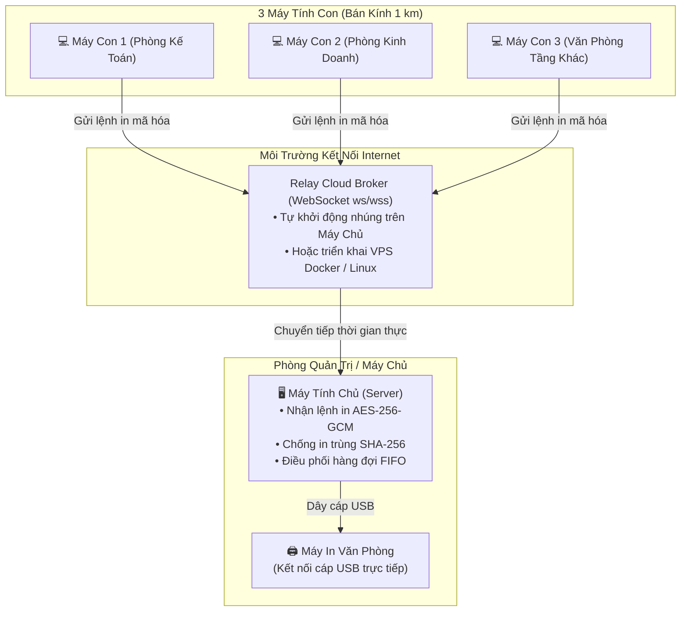

# 🖨️ Remote Print Manager (RPM)

<p align="center">
  <br/>
  
  
  
  
  
  
  
</p>

> **Remote Print Manager (RPM)** là giải pháp phần mềm chuyên dụng cho doanh nghiệp, cho phép nhiều máy tính sử dụng chung một máy in vật lý thông qua **đường truyền Internet hoàn toàn độc lập** trong **phạm vi bán kính 1 km** mà không cần kéo dây mạng, không cần chung Wi-Fi và không cần can thiệp cấu hình Router / NAT Port.

---

## 📑 Mục Lục

* [🎯 Tính Năng Nổi Bật](#-tính-năng-nổi-bật)
* [🏛️ Kiến Trúc Hệ Thống](#️-kiến-trúc-hệ-thống)
* [📥 Tải Về & Cài Đặt Nhanh](#-tải-về--cài-đặt-nhanh)
* [🚀 Hướng Dẫn Sử Dụng Nhanh](#-hướng-dẫn-sử-dụng-nhanh)
  * [1. Dành cho Máy Tính Chủ (Server)](#1-dành-cho-máy-tính-chủ-server)
  * [2. Dành cho 3 Máy Tính Con (Clients)](#2-dành-cho-3-máy-tính-con-clients)
  * [3. Thao tác in ấn hàng ngày (Ctrl + P)](#3-thao-tác-in-ấn-hàng-ngày-ctrl--p)
* [🔄 Quy Trình Cập Nhật & Nâng Cấp Tự Động (Auto-Update)](#-quy-trình-cập-nhật--nâng-cấp-tự-động-auto-update)
* [🛠️ Biên Dịch & Đóng Gói (Build & Packaging)](#️-biên-dịch--đóng-gói-build--packaging)
* [🌐 Hướng Dẫn Triển Khai Lên GitHub](#-hướng-dẫn-triển-khai-lên-github)
* [📂 Cấu Trúc Mã Nguồn](#-cấu-trúc-mã-nguồn)
* [📚 Tài Liệu Hướng Dẫn](#-tài-liệu-hướng-dẫn)

---

## 🎯 Tính Năng Nổi Bật

1. **Bộ Cài Đặt Duy Nhất (Single-File Binary):**
   * Chỉ một tệp `RemotePrintManager.exe` dung lượng siêu nhẹ (~380 KB) sử dụng chung cho cả Máy Chủ và Máy Con. Khởi động lần đầu chỉ cần 1 click để chọn vai trò.
2. **In Ấn Trong Suốt Qua `Ctrl + P`:**
   * Tự động đăng ký máy in ảo vào hệ thống Windows. Nhân viên mở Word, Excel, Chrome, PDF, phần mềm kế toán... nhấn tổ hợp phím **`Ctrl + P`** và in trực tiếp, không cần mở giao diện phần mềm.
3. **Kết Nối Internet Độc Lập (Bán kính 1 km):**
   * Hoạt động ổn định bất kể các máy tính dùng các nhà mạng viễn thông khác nhau (VNPT, Viettel, FPT, mạng 4G/5G) mà không cần cấu hình Router/NAT Port.
4. **Mã Hóa Đầu Cuối Tuyệt Đối (E2EE AES-256-GCM):**
   * Toàn bộ luồng dữ liệu in ấn được mã hóa cấp ngân hàng trước khi truyền qua mạng. Máy chủ trung gian không thể đọc trộm nội dung văn bản.
5. **Chống In Trùng & Điều Phối Hàng Đợi (Deduplication):**
   * Tự động băm tệp tin bằng thuật toán **SHA-256** để phát hiện và ngăn chặn in lặp văn bản khi người dùng bấm đúp hoặc chập chờn mạng. Sắp xếp hàng đợi in FIFO công bằng.
6. **Giao Diện Fluent UI Windows 11 & Vector SVG:**
   * Thiết kế hiện đại, bảng DataGrid không viền đen thô, các tag/badge màu sắc trực quan, biểu tượng hình học SVG sắc nét ở mọi độ phân giải màn hình.
7. **Relay Server Nhúng Tự Động Khởi Động:**
   * Tự động bật máy chủ trung gian ngay trong chế độ Máy Chủ mà không cần cài đặt phần mềm thứ ba.
8. **Cập Nhật Trực Tiếp 1-Click (Canary Testing):**
   * Tự động phát hiện bản cập nhật mới, xác thực mã băm SHA-256 và thay thế tệp thực thi mà không làm mất cấu hình kết nối.
9. **Kết Nối Không Giới Hạn Máy Con & Quản Lý Đa Máy In:**
   * Không giới hạn số lượng máy con trong mã nguồn (mở rộng linh hoạt 10, 20, 50, 100+ máy).
   * Tìm kiếm tức thì, bộ lọc trạng thái và phân nhóm theo phòng ban (Kế toán, Kinh doanh, Hành chính, Kỹ thuật...).
   * Chia sẻ nhiều máy in USB đồng thời và phân quyền sử dụng máy in chi tiết cho từng máy con.
   * Điều phối hàng đợi in đồng thời (Concurrent Queue) không bị nghẽn lệnh hoặc in đè tài liệu.
10. **Tương Thích Đa Thiết Bị Windows & Công Cụ Chẩn Đoán (System Diagnostics):**
   * Hoạt động mượt mà trên Desktop PC, Laptop, Mini PC, Workstation (Dell, HP, Lenovo, ASUS, MSI...).
   * Hỗ trợ tối ưu cả Windows 10 (64-bit) và Windows 11 (64-bit).
   * Tương thích mọi dòng máy in phổ biến: Canon, HP, Brother, Epson, Samsung, Xerox...
   * Tích hợp công cụ chẩn đoán tương thích hệ thống trực quan, hỗ trợ khởi động lại dịch vụ Spooler chỉ với 1 click.

---

## 🏛️ Kiến Trúc Hệ Thống



---

## 📥 Tải Về & Cài Đặt Nhanh

Bạn có thể tải các bản phát hành chính thức tại mục **[Releases](../../releases)**:

| Tệp Tin | Mô Tả | Định Dạng |
| :--- | :--- | :--- |
| **`RemotePrintManager.exe`** | Ứng dụng chạy trực tiếp không cần cài đặt (Khuyên dùng) | Single-File Executable |
| **`RemotePrintManager_v1.0.0_Portable.zip`** | Gói nén di động chứa đầy đủ binary và debug symbols | Zip Archive |
| **`RemotePrintManager_Setup_v1.0.0.exe`** | Bộ cài đặt Windows Wizard có icon Desktop và Startup | Windows Installer |

### Kiểm tra mã băm SHA-256 (Khuyến nghị bảo mật)
```powershell
Get-FileHash -Path ".\RemotePrintManager.exe" -Algorithm SHA256
```

---

## 🚀 Hướng Dẫn Sử Dụng Nhanh

### 1. Dành cho Máy Tính Chủ (Server)
*(Máy tính cắm dây cáp USB trực tiếp vào máy in)*
1. Chạy file `RemotePrintManager.exe` → Chọn **🖥️ THIẾT LẬP LÀM MÁY CHỦ**.
2. Vào tab **Máy In** → Bấm **"Quét máy in trên máy tính"** → Chọn máy in USB và bấm **"Chọn làm máy in chia sẻ"**.
3. Vào tab **Tổng Quan** → Sao chép **Mã Ghép Đôi** (Ví dụ: `RPM-8197`) và gửi cho 3 máy con.
4. Khi máy con kết nối, vào tab **Thiết Bị Kết Nối** → Bấm **"Phê duyệt (Approve)"**.

### 2. Dành cho 3 Máy Tính Con (Clients)
*(3 máy tính nằm trong bán kính 1 km)*
1. Chạy file `RemotePrintManager.exe` → Chọn **💻 THIẾT LẬP LÀM MÁY CON**.
2. Vào tab **Tìm & Kết Nối Máy Chủ** → Nhập mã ghép đôi (ví dụ `RPM-8197`) → Bấm **"Gửi Yêu Cầu Ghép Đôi"**.
3. Sau khi máy chủ bấm duyệt → Vào tab **Máy In Của Tôi** → Bấm **"Cài Đặt Máy In Ảo Vào Windows"**.

### 3. Thao tác in ấn hàng ngày (Ctrl + P)
Nhân viên **không cần mở lại phần mềm RPM**:
* Mở Word, Excel, Chrome, file PDF bất kỳ.
* Nhấn tổ hợp phím **`Ctrl + P`** → Chọn máy in `Remote Printer (RPM)` → Nhấn **Print**.
* Tài liệu sẽ tự động truyền qua Internet và in ra giấy tại máy chủ ngay lập tức.

---

## 🔄 Quy Trình Cập Nhật & Nâng Cấp Tự Động (Auto-Update)

Khi có phiên bản mới được phát hành (ví dụ: `v1.0.1`):
1. **Kiểm tra & Cập nhật 1-Click:** Trên giao diện phần mềm, vào **Cài Đặt** → bấm **"⚡ Cập nhật ngay"**.
2. **Cập nhật thử nghiệm an toàn (Canary Testing):** Quản trị viên nâng cấp thử nghiệm trên **Máy con số 1** trước. Sau khi in thử thành công, tiến hành cập nhật trên các máy còn lại.
3. **Bảo toàn dữ liệu 100%:** Toàn bộ thông tin ghép đôi, danh sách thiết bị và cấu hình được giữ nguyên vẹn trong `%AppData%\RemotePrintManager\config.json`.

---

## 🛠️ Biên Dịch & Đóng Gói (Build & Packaging)

### Yêu cầu hệ thống
* Windows 10/11 x64
* [.NET 9 SDK](https://dotnet.microsoft.com/download/dotnet/9.0)

### Biên dịch và đóng gói tự động
Dự án đi kèm kịch bản tự động hóa [build.ps1](file:///d:/ĐỒ ÁN WEBSITE/GITHUB/PRINTEXE/build.ps1):

```powershell
# Chạy toàn bộ Test, biên dịch Release và đóng gói phân phối:
.\build.ps1 -Version "1.0.0"
```

Kết quả đầu ra nằm tại thư mục `publish/`:
* `publish/RemotePrintManager.exe` — File chạy duy nhất.
* `publish/RemotePrintManager_v1.0.0_Portable.zip` — Gói nén portable.
* `publish/version.json` — Manifest phiên bản chứa mã băm SHA-256.
* `publish/relay/RPM.Relay.exe` — Relay Broker trung gian độc lập.

---

## 🌐 Hướng Dẫn Triển Khai Lên GitHub

### 1. Đẩy dự án lên GitHub
```powershell
git remote add origin https://github.com/<your-username>/RemotePrintManager.git
git branch -M master
git push -u origin master
```

### 2. Tự động phát hành qua GitHub Actions (CI/CD)
Dự án đã tích hợp sẵn workflow tại [.github/workflows/ci-cd.yml](file:///d:/ĐỒ ÁN WEBSITE/GITHUB/PRINTEXE/.github/workflows/ci-cd.yml).
Khi bạn muốn phát hành phiên bản mới, chỉ cần tạo và đẩy tag git:

```powershell
git tag v1.0.0
git push origin v1.0.0
```
GitHub Actions sẽ tự động biên dịch, chạy test, đóng gói và phát hành bản Release kèm toàn bộ file thực thi lên GitHub.

---

## 📂 Cấu Trúc Mã Nguồn

```
PRINTEXE/
├── .github/
│   └── workflows/ci-cd.yml     # Kịch bản GitHub Actions tự động build, test & release
├── deploy/
│   ├── Dockerfile.relay        # Multi-stage Docker container cho máy chủ Relay Linux
│   └── docker-compose.yml      # Khởi động Relay Broker với 1 lệnh
├── docs/
│   ├── USER_MANUAL.md          # Sổ tay hướng dẫn người dùng cuối
│   └── DEPLOYMENT_AND_OPERATIONS.md # Cẩm nang vận hành, đóng gói & triển khai chi tiết
├── installer/
│   └── RemotePrintManager.iss  # Kịch bản đóng gói Inno Setup Windows Installer
├── src/
│   ├── RPM.Core/               # Data models, E2EE AES-256-GCM, SHA-256, Auto-Update Service
│   ├── RPM.Networking/         # WebSocket Relay Engine, Embedded Server, P2P Routing
│   ├── RPM.Printing/           # Windows Spooler helper, IPP spooler, Driver integration
│   ├── RPM.Relay/              # Standalone Cloud Broker cho Linux / Windows Server
│   └── RPM.App/                # Ứng dụng WPF Modern Fluent UI (Server & Client Dashboard)
├── tests/
│   └── RPM.Tests/              # Bộ kiểm thử tự động 100% Pass (Crypto, Protocol, Update)
├── publish/                    # Thư mục xuất bản sau khi chạy build.ps1
└── build.ps1                   # Kịch bản đóng gói và tính SHA-256 tự động
```

---

## 📚 Tài Liệu Hướng Dẫn

* [📖 Sổ Tay Hướng Dẫn Người Dùng (USER_MANUAL.md)](docs/USER_MANUAL.md)
* [📘 Hướng Dẫn Vận Hành & Triển Khai Chi Tiết (DEPLOYMENT_AND_OPERATIONS.md)](docs/DEPLOYMENT_AND_OPERATIONS.md)

---

## 📄 Bản Quyền & Giấy Phép

Phần mềm Remote Print Manager (RPM) phục vụ nhu cầu in ấn văn phòng nội bộ và doanh nghiệp. Mọi thắc mắc hoặc yêu cầu đóng góp tính năng, vui lòng tạo Issue hoặc Pull Request trên GitHub.
